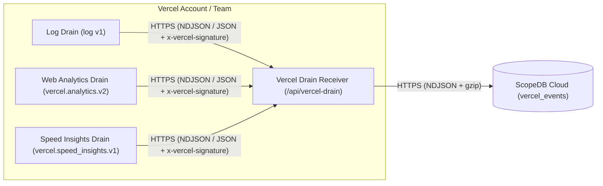

# Vercel Drain Receiver for ScopeDB

Stream [Vercel Drains](https://vercel.com/docs/drains) (Runtime & Request Logs, Web Analytics, and Speed Insights) and Next.js `after()` application events directly into [ScopeDB](https://www.scopedb.io).

## How it works



- **Unified Vercel Drains support**: Normalizes Vercel Log Drains (`vercel.request` and `vercel.log`), Web Analytics Drains (`vercel.pageview` and `vercel.custom_event`), and Speed Insights Drains (`vercel.web_vital`) into a single `scopedb.public.vercel_events` table.
- **Verified webhook security**: Handles Vercel's `x-vercel-verify` handshake and verifies `x-vercel-signature` (`HMAC-SHA1`) using the Web Crypto API (`crypto.subtle.verify`) or a Bearer token (`DRAIN_AUTH_TOKEN`).
- **Explore fields without changing the table**: Query parameters and structured event payloads remain nested in `attributes`, backed by ScopeDB's semi-structured values. Query a new campaign or application parameter without deploying a new column mapping.
- **Reusable analysis views**: Start with HTTP request metrics, error investigation, pageviews/document requests, or AI/content access signals, then adapt the ScopeQL definitions to your application's meaning.
- **Explicit capture policy**: Captures all query parameters visible to the Drain receiver by default as a multi-value mapping (`Record<string, string[]>`), with optional allowlisting and value redaction. Request and Referer paths receive heuristic token redaction. This is not comprehensive removal of credentials or personal data; see [capture policy](#capture-policy).
- **Portable Web Fetch handler**: Runs in a Next.js App Router Route Handler (`app/api/vercel-drain/route.ts`), a standalone Vercel Function, or a Cloudflare Worker with zero Node.js compatibility polyfills.

## 3-step quickstart

### 1. Create the table and views in ScopeDB

Apply the Catalog YAML definitions in [`catalog/`](catalog) using the [ScopeDB CLI](https://www.scopedb.io/docs/guides/scopedb-cli/catalog):

```bash
scope catalog apply --table scopedb.public.vercel_events -f catalog/table.yaml
scope catalog apply --view scopedb.public.v_vercel_requests -f catalog/v_vercel_requests.yaml
scope catalog apply --view scopedb.public.v_vercel_pageviews -f catalog/v_vercel_pageviews.yaml
scope catalog apply --view scopedb.public.v_vercel_errors -f catalog/v_vercel_errors.yaml
scope catalog apply --view scopedb.public.v_vercel_ai_bots -f catalog/v_vercel_ai_bots.yaml
```

| Object                              | Kind  | Definition                                                             | Purpose                                                                                                                               |
| ----------------------------------- | ----- | ---------------------------------------------------------------------- | ------------------------------------------------------------------------------------------------------------------------------------- |
| `scopedb.public.vercel_events`      | Table | [`catalog/table.yaml`](catalog/table.yaml)                             | Base event table storing `vercel.request`, `vercel.log`, `vercel.pageview`, `vercel.custom_event`, and `vercel.web_vital` rows         |
| `scopedb.public.v_vercel_requests`  | View  | [`catalog/v_vercel_requests.yaml`](catalog/v_vercel_requests.yaml)     | Flattened HTTP request, edge cache (`vercel_cache`), function duration, `query`, `utm_*`, and W3C `trace_id`/`span_id` metrics        |
| `scopedb.public.v_vercel_pageviews` | View  | [`catalog/v_vercel_pageviews.yaml`](catalog/v_vercel_pageviews.yaml)   | Client-reported Web Analytics pageviews (`vercel.pageview`) and successful HTTP GET document requests (`vercel.request`)              |
| `scopedb.public.v_vercel_errors`    | View  | [`catalog/v_vercel_errors.yaml`](catalog/v_vercel_errors.yaml)         | All `5xx` responses, failed outcomes, and `error`/`fatal` runtime logs correlated by `request_id` and `trace_id`                     |
| `scopedb.public.v_vercel_ai_bots`   | View  | [`catalog/v_vercel_ai_bots.yaml`](catalog/v_vercel_ai_bots.yaml)       | AI user-agent signals (`is_ai_user_agent`) and Markdown/llms.txt requests (`is_markdown_request`), exposed as separate boolean flags |

### 2. Mount the Drain receiver in Next.js or deploy standalone

In a Next.js App Router project, export the GET and POST handlers from `app/api/vercel-drain/route.ts`:

```ts
import { createNextRouteHandler } from "vercel-drain";

const handler = createNextRouteHandler();

export const GET = handler;
export const POST = handler;
```

Configure the environment variables in your deployment:

| Variable               | Required | Default         | Description                                                                             |
| ---------------------- | -------- | --------------- | --------------------------------------------------------------------------------------- |
| `SCOPEDB_ENDPOINT`     | Yes      | —               | ScopeDB Cloud workspace endpoint (for example, `https://<id>.scopedb.cloud`)            |
| `SCOPEDB_API_KEY`      | Yes      | —               | ScopeDB workspace API key with append access to the target table                        |
| `VERCEL_DRAIN_SECRET`  | Yes*     | —               | Vercel Drain Signing Secret used to verify `x-vercel-signature` (`HMAC-SHA1`)           |
| `DRAIN_AUTH_TOKEN`     | Yes*     | —               | Optional Bearer token alternative if authenticating via `Authorization: Bearer <token>` |
| `VERCEL_VERIFY_TOKEN`  | No       | —               | Optional verification challenge echoed in `x-vercel-verify`                             |
| `SCOPEDB_DATABASE`     | No       | `scopedb`       | Target database name                                                                    |
| `SCOPEDB_SCHEMA`       | No       | `public`        | Target schema name                                                                      |
| `SCOPEDB_TABLE`        | No       | `vercel_events` | Target table name                                                                       |

### 3. Connect Vercel Drains or Next.js `after()`

In your Vercel dashboard, open **Team Settings > Drains**, create a Drain pointing to your `/api/vercel-drain` endpoint (`NDJSON` or `JSON`), and copy the Signing Secret into `VERCEL_DRAIN_SECRET`.

For in-application business or AI SDK events on any Vercel plan (including Hobby), use `scopedb` inside Next.js `after()`:

```ts
import { after } from "next/server";
import { Client } from "scopedb";

const client = new Client(process.env.SCOPEDB_ENDPOINT!, {
  apiKey: process.env.SCOPEDB_API_KEY!,
});
const appender = client.table("vercel_events", {
  database: "scopedb",
  schema: "public",
}).appender();

export async function POST(request: Request) {
  after(async () => {
    await appender.append([
      {
        event_id: crypto.randomUUID(),
        occurred_at: new Date().toISOString(),
        service: "my-nextjs-app",
        event_type: "vercel.custom_event",
        outcome: "ok",
        level: "info",
        method: "POST",
        host: new URL(request.url).hostname,
        path: new URL(request.url).pathname,
        status: 200,
        request_id: request.headers.get("x-vercel-id"),
        message: "ai.completion.finished",
        attributes: { model: "claude-sonnet-4-5", tokens: 842 },
      },
    ]);
  });

  return Response.json({ ok: true });
}
```

## Data and analysis contracts

Each Vercel Log Drain item carrying HTTP proxy metadata becomes one `vercel.request` row, plus one `vercel.log` row when a non-static runtime log message is present. `request_id` (`x-vercel-id`) and `attributes['trace_id']` link them. Count `vercel.request` rows for HTTP request volume; counting the base table or `v_vercel_errors` counts events and can count one invocation twice when a route logs an error and returns `5xx`.

Application query parameters remain in `attributes['query']` as an object of string arrays: `?tag=a&tag=b&empty=` becomes `{"tag":["a","b"],"empty":[""]}`. Values are URL-decoded once, duplicates retain their order, and keys are case-sensitive. Values are not truncated or heuristically redacted by the collector. The `utm_*` and `ref` columns in `v_vercel_requests` and `v_vercel_pageviews` select the first occurrence (`attributes['query']['utm_*'][0]::string`), with a fallback to top-level attributes on older records.

Views define analysis rules rather than additional ingestion schemas:

- `v_vercel_requests` exposes one row per HTTP request (`event_type = 'vercel.request'`), including edge cache (`vercel_cache`), function duration (`duration_ms`), attribution, and W3C `trace_id`/`span_id`.
- `v_vercel_pageviews` includes both client-reported Web Analytics Drain rows (`event_type = 'vercel.pageview'`) and successful server-observed HTTP GET requests (`event_type = 'vercel.request' AND method = 'GET' AND status = 200`), excluding `/api/*`, `/_next/*`, `/_vercel/*`, `/_app/*`, static file extensions, and known bots. When both Web Analytics Drains and Log Drains are enabled for the same project, filter `WHERE event_type = 'vercel.pageview'` (for client-side SPA beacons) or `WHERE event_type = 'vercel.request'` (for server-observed HTTP GET requests) so a single page load is not counted twice. Note that Vercel Log Drains do not include `Sec-Fetch-*` or `Next-Router-Prefetch` request headers, so server-observed `vercel.request` rows cannot filter out background SPA prefetches unless your middleware tags or excludes them.
- `v_vercel_ai_bots` exposes `is_ai_user_agent` (a spoofable user-agent match) and `is_markdown_request` (requests to `/llms.txt` or `*.md`). It includes rows matching either signal. A Markdown request alone is content access, not verified AI identity.
- `v_vercel_errors` exposes `5xx` responses, failed outcomes, and `error`/`fatal` runtime logs. Use `request_id` or `trace_id` to correlate or deduplicate failures from the same invocation.

## Example ScopeQL queries

### Compare HTTP request volume, errors, and function duration by project

```scopeql
FROM scopedb.public.v_vercel_requests
WHERE occurred_at >= NOW() - '24h'::interval
GROUP BY service
AGGREGATE
    count() AS requests,
    sum(if(status >= 500 OR outcome != 'ok', 1, 0)) AS errors,
    avg(duration_ms) AS avg_duration_ms,
    max(duration_ms) AS max_duration_ms
ORDER BY requests DESC
```

### Explore an application query parameter without changing ingestion

```scopeql
FROM scopedb.public.v_vercel_requests
WHERE occurred_at >= NOW() - '24h'::interval
SELECT occurred_at, service, path, query['plan'][0]::string AS plan, query['tag'] AS tags
ORDER BY occurred_at DESC
LIMIT 50
```

### Distinguish AI user-agent signals from Markdown content access

```scopeql
FROM scopedb.public.v_vercel_ai_bots
WHERE occurred_at >= NOW() - '168h'::interval
GROUP BY is_ai_user_agent, is_markdown_request
AGGREGATE count() AS requests
ORDER BY requests DESC
```

### Correlate 5xx responses and runtime error logs by `request_id` and `trace_id`

```scopeql
FROM scopedb.public.v_vercel_errors
WHERE occurred_at >= NOW() - '6h'::interval
SELECT occurred_at, service, event_type, status, path, request_id, trace_id, message
ORDER BY occurred_at DESC
LIMIT 50
```

## Render web and AI traffic charts with `$scopedb` and `@scopedb/scopeview`

With the [ScopeDB Agent Skill](https://github.com/scopedb/scopedb-skills) (`$scopedb`) and [`@scopedb/scopeview`](https://github.com/scopedb/scopeview), your coding agent can query `v_vercel_pageviews`, `v_vercel_ai_bots`, and `v_vercel_errors` and export offline interactive HTML charts on demand:

```text
Use $scopedb to analyze observed Vercel traffic over the last 168 hours from scopedb.public.v_vercel_pageviews, scopedb.public.v_vercel_ai_bots, and scopedb.public.v_vercel_errors, and render @scopedb/scopeview interactive HTML charts for:
1. Hourly pageviews or document requests over time, filtered by event_type (line chart)
2. Top 15 paths by event_type (top-list chart)
3. Top external referrers and first UTM source values (top-list chart)
4. Request counts grouped by is_ai_user_agent and is_markdown_request (top-list chart of mutually exclusive combinations)
5. 5xx and runtime error counts by path and event_type (bar chart)
Keep AI user-agent and Markdown content signals separate, and filter v_vercel_pageviews by event_type when both Web Analytics and Log Drains are active.
```

## Capture policy

Full query capture can retain credentials, email addresses, search terms, and other personal or application data. Unlike Cloudflare Tail Workers, Vercel Log Drains deliver raw request paths and query strings without platform-side token redaction. Retention and access controls must match the data you choose to capture.

The collector omits URL fragments and Referer query strings. It inspects decoded request and Referer path segments and redacts recognizable high-entropy hex (`>=32` chars), prefixed hex tokens (such as `tok_<hex>`), mixed-case Base64-like tokens (`>=21` chars), and Luhn payment-card patterns to `REDACTED`. Paths are limited to 2,048 characters and Error stacks in event payloads to 8,192 characters. Short secrets and personal data in paths or query values require an explicit application rule.

Configure `createVercelDrainHandler` or `createNextRouteHandler` with `allowedQueryParams`, `redactQueryValue`, and `redactPath`:

```ts
import { createNextRouteHandler } from "vercel-drain";

const handler = createNextRouteHandler({
  allowedQueryParams: ["utm_source", "utm_medium", "utm_campaign", "plan"],
  redactQueryValue: (key, value) =>
    key === "plan" && !["free", "team"].includes(value) ? null : value,
  redactPath: (pathname) => pathname.replace(/^\/reset\/[^/]+/, "/reset/:token"),
});

export const GET = handler;
export const POST = handler;
```

## Filtering and delivery

The default handler records all normalized rows. Pass `shouldRecord(row, rawItem)` to omit high-volume health checks while retaining errors:

```ts
const handler = createNextRouteHandler({
  shouldRecord: (row) => row.level === "error" || (row.status ?? 0) >= 400 || row.path !== "/api/health",
});
```

Each webhook request sends its batch to ScopeDB and waits for delivery. The SDK retries eligible failures up to twice, with a 10-second attempt timeout and a 25-second elapsed budget per batch. Network failures and timeouts can leave the commit outcome unknown; the handler reports failure without automatically replaying an ambiguous write.

## Development

```bash
pnpm install
pnpm run ci
```

To execute all four Catalog definitions against a local ScopeDB test server:

```bash
SCOPEDB_TEST_ENDPOINT=http://127.0.0.1:6543 pnpm run test:catalog
```

## License

Licensed under the [Apache License, Version 2.0](LICENSE).
