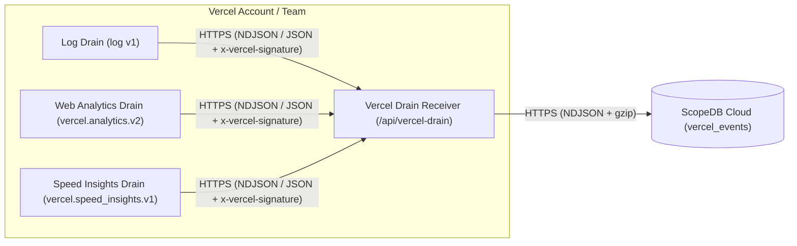

# Vercel Drain Receiver for ScopeDB

Stream [Vercel Drains](https://vercel.com/docs/drains) (Runtime & Request Logs, Web Analytics, and Speed Insights) and Next.js `after()` application events directly into [ScopeDB](https://www.scopedb.io).

## How it works



- **Unified Vercel Drains support**: Normalizes Vercel Log Drains (`vercel.request` and `vercel.log`), Web Analytics Drains (`vercel.pageview` and `vercel.custom_event`), and Speed Insights Drains (`vercel.web_vital`) into a single `scopedb.public.vercel_events` table.
- **Verified webhook security**: Handles Vercel's `x-vercel-verify` handshake and verifies `x-vercel-signature` (`HMAC-SHA1`) using the Web Crypto API (`crypto.subtle.verify`) or a Bearer token (`DRAIN_AUTH_TOKEN`).
- **Structured URL & attribution extraction**: Parses URL path, query object (`attributes['query']`), `Referer` host/path (stripping `Referer` query strings and fragments), and standard `utm_source`, `utm_medium`, `utm_campaign`, `utm_term`, `utm_content`, and `ref` attribution keys.
- **Portable Web Fetch handler**: Runs in a Next.js App Router Route Handler (`app/api/vercel-drain/route.ts`), a standalone Vercel Function, or a Cloudflare Worker with zero Node.js compatibility polyfills.

## 3-step quickstart

### 1. Create the table and views in ScopeDB

Apply the Catalog YAML definitions in [`catalog/`](catalog) using the [ScopeDB CLI](https://www.scopedb.io/docs/guides/scopedb-cli/catalog):

```bash
scope catalog apply --table scopedb.public.vercel_events -f catalog/table.yaml
scope catalog apply --view scopedb.public.v_vercel_requests -f catalog/v_vercel_requests.yaml
scope catalog apply --view scopedb.public.v_vercel_pageviews -f catalog/v_vercel_pageviews.yaml
scope catalog apply --view scopedb.public.v_vercel_errors -f catalog/v_vercel_errors.yaml
scope catalog apply --view scopedb.public.v_vercel_ai_bots -f catalog/v_vercel_ai_bots.yaml
```

| Object                              | Kind  | Definition                                                             | Purpose                                                                                                             |
| ----------------------------------- | ----- | ---------------------------------------------------------------------- | ------------------------------------------------------------------------------------------------------------------- |
| `scopedb.public.vercel_events`      | Table | [`catalog/table.yaml`](catalog/table.yaml)                             | Base event table storing `vercel.request`, `vercel.log`, `vercel.pageview`, `vercel.custom_event`, and `vercel.web_vital` rows |
| `scopedb.public.v_vercel_requests`  | View  | [`catalog/v_vercel_requests.yaml`](catalog/v_vercel_requests.yaml)     | Flattened HTTP request, edge cache (`vercel_cache`), function duration, and W3C `trace_id`/`span_id` metrics        |
| `scopedb.public.v_vercel_pageviews` | View  | [`catalog/v_vercel_pageviews.yaml`](catalog/v_vercel_pageviews.yaml)   | Clean browser pageviews across Web Analytics Drains and `GET 200` HTTP requests excluding bots and static assets    |
| `scopedb.public.v_vercel_errors`    | View  | [`catalog/v_vercel_errors.yaml`](catalog/v_vercel_errors.yaml)         | All `5xx` responses, failed outcomes, and `error`/`fatal` runtime logs                                              |
| `scopedb.public.v_vercel_ai_bots`   | View  | [`catalog/v_vercel_ai_bots.yaml`](catalog/v_vercel_ai_bots.yaml)       | Requests to `/llms.txt` or `*.md` and traffic from AI crawlers and coding agents (`ClaudeBot`, `GPTBot`, `Cursor`)  |

### 2. Mount the Drain receiver in Next.js or deploy standalone

In a Next.js App Router project, export the GET and POST handlers from `app/api/vercel-drain/route.ts`:

```ts
import { createNextRouteHandler } from "vercel-drain";

const handler = createNextRouteHandler();

export const GET = handler;
export const POST = handler;
```

Configure the environment variables in your deployment:

| Variable               | Required | Default         | Description                                                                             |
| ---------------------- | -------- | --------------- | --------------------------------------------------------------------------------------- |
| `SCOPEDB_ENDPOINT`     | Yes      | —               | ScopeDB Cloud workspace endpoint (for example, `https://<id>.scopedb.cloud`)            |
| `SCOPEDB_API_KEY`      | Yes      | —               | ScopeDB workspace API key with append access to the target table                        |
| `VERCEL_DRAIN_SECRET`  | Yes*     | —               | Vercel Drain Signing Secret used to verify `x-vercel-signature` (`HMAC-SHA1`)           |
| `DRAIN_AUTH_TOKEN`     | Yes*     | —               | Optional Bearer token alternative if authenticating via `Authorization: Bearer <token>` |
| `VERCEL_VERIFY_TOKEN`  | No       | —               | Optional verification challenge echoed in `x-vercel-verify`                             |
| `SCOPEDB_DATABASE`     | No       | `scopedb`       | Target database name                                                                    |
| `SCOPEDB_SCHEMA`       | No       | `public`        | Target schema name                                                                      |
| `SCOPEDB_TABLE`        | No       | `vercel_events` | Target table name                                                                       |

### 3. Connect Vercel Drains or Next.js `after()`

In your Vercel dashboard, open **Team Settings > Drains**, create a Drain pointing to your `/api/vercel-drain` endpoint (`NDJSON` or `JSON`), and copy the Signing Secret into `VERCEL_DRAIN_SECRET`.

For in-application business or AI SDK events on any Vercel plan (including Hobby), use `scopedb` inside Next.js `after()`:

```ts
import { after } from "next/server";
import { Client } from "scopedb";

const client = new Client(process.env.SCOPEDB_ENDPOINT!, {
  apiKey: process.env.SCOPEDB_API_KEY!,
});
const appender = client.table("vercel_events", {
  database: "scopedb",
  schema: "public",
}).appender();

export async function POST(request: Request) {
  after(async () => {
    await appender.append([
      {
        event_id: crypto.randomUUID(),
        occurred_at: new Date().toISOString(),
        service: "my-nextjs-app",
        event_type: "vercel.custom_event",
        outcome: "ok",
        level: "info",
        method: "POST",
        host: new URL(request.url).hostname,
        path: new URL(request.url).pathname,
        status: 200,
        request_id: request.headers.get("x-vercel-id"),
        message: "ai.completion.finished",
        attributes: { model: "claude-sonnet-4-5", tokens: 842 },
      },
    ]);
  });

  return Response.json({ ok: true });
}
```

## Development

```bash
pnpm install
pnpm run ci
```

## License

Licensed under the [Apache License, Version 2.0](LICENSE).
